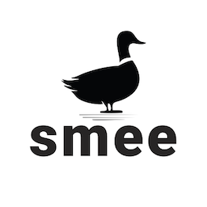

# Smee


`Smee` is a pragmatic library for handling SAML metadata with Elixir, Erlang or any other BEAM language.

Smee started life as an sprawling mess of code used over five years in an internal application to download and process
SAML metadata. It's now been extracted, restructured and cleaned up, with the aim of reusing it in other 
projects. Smee can be used within applications or in simpler scripts for processing metadata.

[](https://hex.pm/packages/smee)
[](http://hexdocs.pm/smee/)


[](https://livebook.dev/run?url=https%3A%2F%2Fraw.githubusercontent.com%2FDigital-Identity-Labs%2Fsmee%2Fmain%2Fsmee_notebook.livemd)

## Features

* Download remote SAML metadata or load local files, with effective caching
* Manage and compare metadata files and individual entity metadata 
* MDQ API (which can also emulate MDQ style lookups with aggregate files)
* A focus on streaming with reliable and surprisingly low memory usage
* Filter entity streams by various criteria
* Validate XML signatures, automatically download and confirm signing certificates
* Transform metadata using XSLT, or extract data
* Access XML using Erlang's Xmerl library (sweetened by SweetXML)
* Recombine entity streams into aggregates or other data formats
* Can be used with applications or in simple .exs scripts
* Swappable XML-processing backends: Rust NIF, external LibXML tools or distributed processing 

The top level `Smee` module contains simplified, top level functions better suited to simpler scripts. Other modules in
Smee contain more tools for handling SAML metadata, such as:

* `Smee.Source` - define sources of metadata
* `Smee.Metadata` - functions for handling metadata aggregates
* `Smee.Entity` - individual SAML entity definitions
* `Smee.Extract` - processing metadata to extract information
* `Smee.Fetch` - downloading metadata sources
* `Smee.MDQ` - functions for MDQ clients (and emulating MDQ clients)
* `Smee.Filter` - filtering streams of entity records
* `Smee.Transform` - processing and editing entity XML
* `Smee.Publish` - Formatting and outputting metadata in various formats
* `Smee.Stats` - Simple stats for entity streams
* `Smee.Sigils` - An ~x sigil for XPaths optimized for use with SAML

## Extensions and Extras

* [SmeeFeds](https://github.com/Digital-Identity-Labs/smee_feds) - a federation management extension for use in
  research, testing and development. SmeeFeds has a built-in list of many education and research federations.
* [SmeeView](https://github.com/Digital-Identity-Labs/smee_view) - an experimental package for extracting information
  from metadata XML - if it's in there, SmeeView should make it easy to extract and process.
* [SmeeOrgs](https://github.com/Digital-Identity-Labs/smee_orgs) - Extract, merge and enhance Organization information from metadata 
* [SmeeLogos](https://github.com/Digital-Identity-Labs/smee_logos) - Fetch, process and audit logo data in metadata 

## Examples

### Getting entity details from an MDQ service

```elixir
alias Smee.MDQ

cern_idp = 
  MDQ.source("http://mdq.ukfederation.org.uk/")
  |> MDQ.lookup!("https://cern.ch/login")

```

### Downloading and streaming a metadata aggregate to output a list of all IdP entityIDs

```elixir
alias Smee.{Source, Fetch, Filter, Metadata}

"http://metadata.ukfederation.org.uk/ukfederation-metadata.xml"
|> Source.new()
|> Fetch.remote!()
|> Metadata.stream_entities()
|> Filter.idp()
|> Stream.map(fn e -> e.uri end)
|> Enum.to_list()

```

### Create an aggregate that only contains SPs with SIRTFI, that were registered over the previous 12 months 

```elixir
alias Smee.{Source, Fetch, Filter, Metadata, Publish}

"http://metadata.ukfederation.org.uk/ukfederation-metadata.xml"
|> Source.new()
|> Fetch.remote!()
|> Metadata.stream_entities()
|> Filter.days(365)
|> Filter.sp()
|> Filter.assurance("https://refeds.org/sirtfi")
|> Publish.write_aggregate()

```
### Munge XML with XSLT

```elixir
alias Smee.{Source, Fetch, Transform, Metadata}

## Using a builtin function

new_xml = Source.new("adfs.xml")
|> Fetch.local!()
|> Transform.decruft_sp!()
|> Metadata.xml()

File.save!("adfs_new.xml", new_xml)

## Or any XSLT stylesheet

{:ok, updated_metadata} = Transform.transform(metadata, stylesheet, [exampleParam: "example value"])

```

## Installation

If [available in Hex](https://hex.pm/docs/publish), the package can be installed
by adding `Smee` to your list of dependencies in `mix.exs`:

```elixir
def deps do
  [
    {:smee, "~> 0.8.0"}
  ]
end
```

## XML Backends

It is now possible to select an XML-processing backend. The XML backend is responsible for tidying, verify and validating XML,
applying stylesheets and extracting reports. 

### Selecting an XML backend

Currently three backends are supported:

* `:uppsala` - `Smee.XMLProcessor.Uppsala` Uses a Rust NIF embedded into Smee (the default)
* `:libxml_tools` - `Smee.XMLProcessor.LibXMLTools` Uses external UNIX tools from the LibXML project
* `:legacy` - `Smee.XMLProcessor.Legacy` Uses external UNIX tools from the LibXML project (deprecated, see below)

The active backend can be selected using a config option in your application:

```elixir
# Use a shortcut name for a built-in backend
config :smee, :xml_processor, :libxml_tools
```

```elixir
# Specify a module directly, useful when writing your own backend
config :smee, :xml_processor, Smee.XMLProcessor.Uppsala
```

If you are happy to use the default backend (`Smee.XMLProcessor.Uppsala`) then no configuration is necessary. You will
almost certainly not need to use the backend directly.

### Supported XML Backends

`Smee.XMLProcessor.Uppsala` is the new default XML backend and is based on the excellent new Rust libraries Uppsala and Bergshamra by
[Kushal Das](https://github.com/kushaldas) at [SUNET](https://www.sunet.se/en). Uppsala and Bergshamra are used by [PyFF](https://github.com/IdentityPython/pyFF) and a few other academic SAML projects. They are actively developed, well-supported and very capable libraries. When using the Uppsala backend no external tools are required,
so Smee will work with normal LiveBooks and other systems lacking UNIX tools.

`Smee.XMLProcessor.LibXMLTools` is an alternative to `Smee.XMLProcessor.Uppsala` that relies on external UNIX tools. It uses the excellent new 
[Forcola](https://hex.pm/packages/forcola) package to safely manage external tools. 

If you have selected the `:legacy` or `:libxml_tools` XML processing backends then you must install the following executables:

* `xmlsec1`
* `xmllint`
* `xsltproc`

Smee now includes a Mix task to install the default backend software - just run:

`mix deps.smee`

(Currently only tested on Macs with Homebrew, but it *should* also work on Debian, Ubuntu, Red Hat and Alpine Linux)

### The Legacy Backend: Rambo and Rust (TLDR: avoid it)

The Legacy backend uses an Elixir library called [Rambo](https://hex.pm/packages/rambo) to run external utilities like xsltproc. Rambo 
relies on a small compiled shim that is provided pre-compiled for various architectures or automatically built during installation.

- If your system does not match any of the supplied binary shims, you will need to have a rust compiler installed so Rambo
  can build the shim itself. 
- Version 0.3.4 of Rambo has an additional problem: it does not ship with a precompiled binary for M1 Macs, *and it also does
  not automatically build one*. Smee works around that with an explicit compile step in `mix.exs`, but it prevent Smee from
  being used in Elixir .exs scripts on M1 Macs unless you copy the compiled shim from Smee into your script's build directory.
  Hopefully this will be fixed in later versions of Rambo. 
- If you are using a modern M1/M2/M3 Mac you may need to explicitly include Rambo as a dependency in your project.

This is why the Legacy backend (the original XML processing code in Smee) is now deprecated. The default backend does not
require this fix, and the optional LibXMLTools backend does not depend on Rambo.

## Uses

Smee is best suited to consuming metadata: reports, databases, service catalogues, discovery and so on. It can be used to
manage the metadata consumed by an organisation. But while it could be used to produce metadata at a federation or publisher
it was not initially designed with this in mind and has not been used for this yet in production. See the next section for some
alternatives better suited to publishing federated metadata.


We've used Smee for the following projects:

* Metadata Database: Smee was extracted from an application that downloads, processes and stores SAML metadata in a database for access 
with an API. The original code had become rather messy and was very difficult to test - Smee is a huge improvement.
* MDQ service: We've made a streaming MDQ service using Smee that should eventually be open-sourced
* We've generated reports for clients using Smee
* A federated authentication observability application for universities and colleges
* A metadata management application
* A database-less metadata browser
* Producing JSON data files for a WAYF/Disco service written in Vue
* Producing JSON data files for a SAML test application
* An entity logo processing service

## Possible Alternatives

These aren't quite the same but are mature, widely used projects that are a lot more stable than Smee. Publishers and federations 
should probably use these instead of Smee when creating metadata aggregates.

* [SAML Library by Tom Scavo](https://github.com/trscavo/saml-library/) A collection of Bash and XSLT scripts 
* [PyFF](https://github.com/IdentityPython/pyFF) A metadata pipeline and server using Python and YAML
* [Shibboleth Metadata Aggregator](https://shibboleth.atlassian.net/wiki/spaces/MA1/overview) Widely used Java metadata pipeline

## References

### SAML Metadata
* [Wikipedia's summary](https://en.wikipedia.org/wiki/SAML_2.0)

### MDQ 
* [UK Federation Explains MDQ](https://www.ukfederation.org.uk/content/Documents/MDQ)

### Unusual types of SAML metadata
* [Oauth/OIDC](https://shibboleth.atlassian.net/wiki/spaces/SC/pages/1912406916/OAuthRPMetadataProfile)
* [ADFS does it's own thing](https://shibboleth.atlassian.net/wiki/spaces/SC/pages/1836417024/ADFSMetadataProfile)
* [CAS!](https://shibboleth.atlassian.net/wiki/spaces/SC/pages/1879344655/CASMetadataProfile)

## Contributors and Sources

Various Github repositories have been plundered in a search for XSLT stylesheets, in particular:

* [SAML Library by Tom Scavo](https://github.com/trscavo/saml-library/)
* [SWAMID Federation](https://swamid.se/swamid-metadata.git/tree/xslt)
* [UK Access Management Federation's metadata processing pipeline](https://github.com/ukf/ukf-meta)

https://github.com/ukf/ukf-meta/

The use of the Apache2 license in the above projects led to the Apache2 license for Smee.

Other sources and inspirations:

* [The XSLT package for Elixir](https://github.com/johnhamelink/xslt)

Smee temporarily includes a copy of [EasySSL](https://github.com/CaliDog/EasySSL) (MIT Licensed) that was required to
fix an Erlang 26 compatibility issue. This will revert to a normal dependency when an update is released.

## Documentation

Documentation can be generated with [ExDoc](https://github.com/elixir-lang/ex_doc)
and published on [HexDocs](https://hexdocs.pm). Once published, the docs can
be found at <https://hexdocs.pm/smee>.

## Contributing

You can request new features by creating an [issue](https://github.com/Digital-Identity-Labs/smee/issues),
or submit a [pull request](https://github.com/Digital-Identity-Labs/smee/pulls) with your contribution.

This software was produced without generative AI and no contributions from generative AI will be accepted.

If you are comfortable working with Python but Smee's Elixir code is unfamiliar then this blog post may help: 
[Elixir For Humans Who Know Python](https://hibox.live/elixir-for-humans-who-know-python)

## Copyright and License

Copyright (c) 2023, 2026 Digital Identity Ltd, UK

Smee is Apache 2.0 licensed.

## Disclaimer
Smee is not endorsed by The Shibboleth Foundation or any of the NREN's that may have had their XSLT borrowed.
